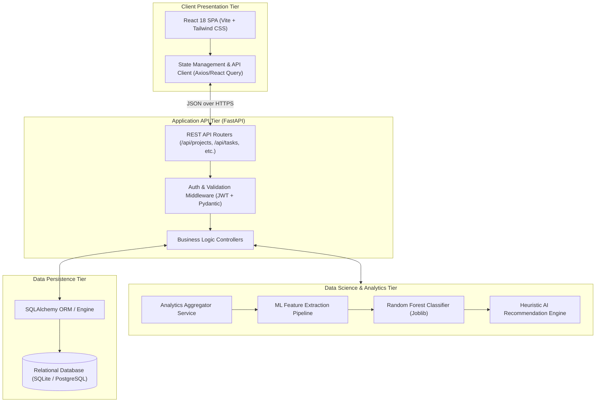
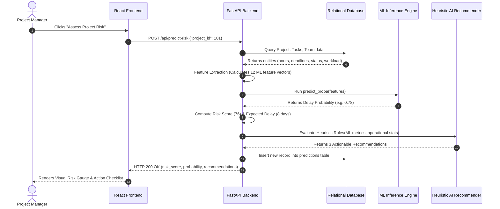
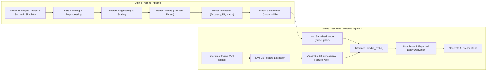
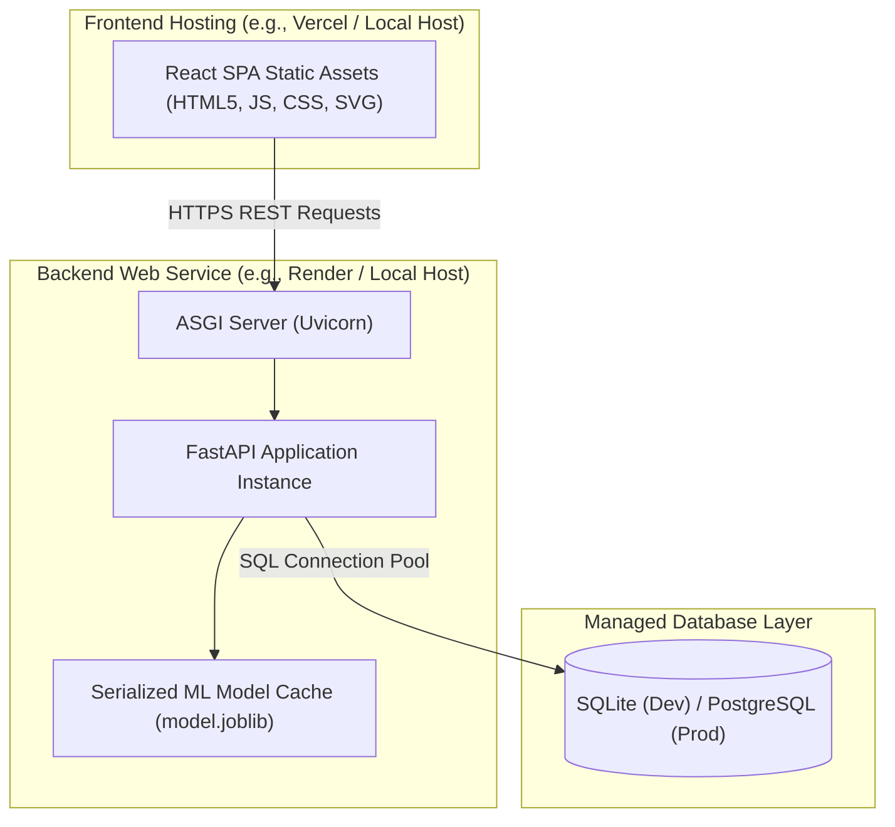

# ProjectPulse — System Architecture Document

**Document Code:** ARCH-PP-V1.0  
**Target Release:** Internship MVP v1.0  
**Status:** Approved  

---

## 1. Architectural Overview

ProjectPulse is designed around a clean, decoupled, tiered architecture optimized for high reliability, responsiveness, and academic explainability. It avoids microservice fragmentation and over-engineering by utilizing a robust **Modular Monolithic API** paired with an independent **Single Page Application (SPA)** frontend and a co-located **Data Science / ML Service layer**.

```
[ Frontend (React SPA / Vite) ]
               │  HTTP / REST (JSON)
               ▼
[ Backend API (FastAPI / Python) ]
       │                      │
       ├────────────────┐     │ Direct Engine Call
       ▼                ▼     ▼
[ Database ]      [ Analytics Engine ]
(SQLite / PG)           │
                        ▼
               [ ML Prediction Engine ]
               (Random Forest Pipeline)
                        │
                        ▼
               [ Risk & AI Recs Output ]
                        │
                        ▼
               [ Dashboard UI Update ]
```

---

## 2. Component Architecture

The high-level system architecture consists of five core tiers:



### Component Breakdown
1. **Client Tier (Presentation):** Built with React 18 and Vite. Features modular views for Project Portfolio, Task Kanban/List, Analytics Charts, and AI Insights.
2. **API Tier (FastAPI):** Python 3.10+ asynchronous backend. Handles routing, request schema validation via Pydantic models, JWT session verification, and transactional orchestration.
3. **Analytics & ML Tier (Data Science):** Co-located within the Python backend runtime to eliminate inter-process network overhead. Computes descriptive statistics (completion %, hour burn, workload variance) and performs sub-millisecond ML model inference using scikit-learn.
4. **Data Persistence Tier:** Abstracted through SQLAlchemy ORM, supporting zero-setup local SQLite during development and robust PostgreSQL in production environments.

---

## 3. End-to-End Data Flow

The lifecycle of data through the system follows a predictable, deterministic request-response cycle:



---

## 4. Machine Learning Pipeline Architecture

The Machine Learning subsystem is partitioned into an **Offline Training Pipeline** and an **Online Real-Time Inference Pipeline**:



### 4.1 ML Pipeline Steps
1. **Feature Extraction:** Directly queries project metadata, task records, and team assignments to assemble the exact 12-dimensional vector defined in the ML specification.
2. **Model Loading:** The pre-trained Random Forest model is loaded into server memory at application startup (singleton pattern), avoiding cold-start disk I/O on inference requests.
3. **Inference Execution:** The model evaluates the feature array and outputs probability distributions $P(\text{Delayed}=0)$ and $P(\text{Delayed}=1)$.
4. **Post-Processing & Rule Synthesis:** The raw probability is scaled into a standardized 0–100 Risk Score, expected schedule slip days are calculated, and the recommendation rules generate prescriptive remedies.

---

## 5. Security Architecture

Even as an internship-quality MVP, ProjectPulse embeds foundational application security controls:

```
[ Client Request ]
       │
       ▼
[ CORS Filter ] ──> Validates Request Origin
       │
       ▼
[ Rate Limiter ] ──> Protects against burst abuse (60 req/min)
       │
       ▼
[ JWT Authenticator ] ──> Verifies Bearer Token Signature & Expiry
       │
       ▼
[ Pydantic Validator ] ──> Enforces strict type schemas & prevents SQLi
       │
       ▼
[ Business Logic & ORM ] ──> Parameterized SQL queries prevent injection
```

### Security Measures Implemented
- **Stateless Authentication:** Secure JSON Web Tokens (JWT) signed with HMAC-SHA256, carrying user ID, role, and expiration timestamp.
- **Password Protection:** Cryptographic hashing using `bcrypt` (12 work factor salt rounds). Plaintext passwords are never persisted or logged.
- **Strict Input Validation:** Every incoming payload is validated against strict Pydantic schemas. Unrecognized or malformed fields are rejected with HTTP 422 Unprocessable Entity.
- **SQL Injection Prevention:** All database operations utilize SQLAlchemy ORM parameterized queries; raw dynamic SQL construction is prohibited.
- **Cross-Origin Resource Sharing (CORS):** Backend restricts origins explicitly to the frontend host environment (e.g., `http://localhost:5173` in development).

---

## 6. Deployment Architecture

ProjectPulse follows an agile, lightweight deployment architecture that runs seamlessly on local developer workstations and can be deployed to zero-cost/low-cost cloud tiers (e.g., Vercel + Render):



### Deployment Characteristics
- **Stateless Application Layer:** The FastAPI server is completely stateless. All application state is stored in the database, enabling seamless restarts and zero-downtime redeployments.
- **Embedded Model Asset:** The trained Random Forest artifact (`model.joblib`) is bundled directly with the application source code or mounted via a persistent volume, ensuring zero network latency when invoking ML models.
- **Modular Environment Configuration:** All operational settings (database URL, secret keys, debug flags) are injected via standard `.env` configuration files.
