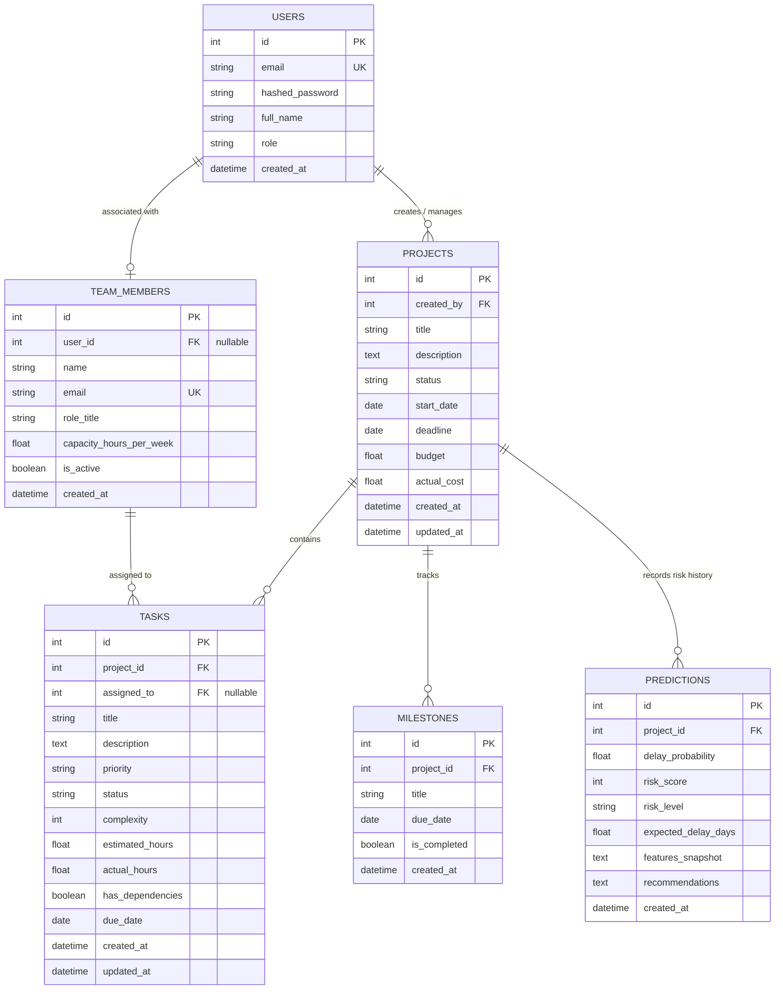

# ProjectPulse — Database Design Specification

**Document Code:** DB-PP-V1.0  
**Target Release:** Internship MVP v1.0  
**Database Engines:** SQLite 3 (Development) / PostgreSQL 14+ (Production)  
**ORM:** SQLAlchemy 2.0+ (Declarative Mapping)  
**Status:** Approved  

---

## 1. Overview and Relational Strategy

The ProjectPulse data model is designed to support core project management workflows, fine-grained task tracking, team resource management, and historical machine learning prediction telemetry. 

To maintain simplicity and prevent over-engineering for an internship MVP, the database implements a normalized relational design (Third Normal Form - 3NF). It explicitly defines integrity constraints, foreign key cascades, and indexing strategies that ensure high-speed aggregation for real-time analytics.

---

## 2. Entity-Relationship (ER) Diagram



---

## 3. Entity Specifications

### 3.1 Entity: `users`
Stores system accounts, access credentials, and role authorizations.

| Field Name | Data Type | Constraints | Description |
| :--- | :--- | :--- | :--- |
| `id` | `INTEGER` | `PRIMARY KEY AUTOINCREMENT` | Unique identifier for user |
| `email` | `VARCHAR(255)` | `NOT NULL, UNIQUE` | Login email address |
| `hashed_password` | `VARCHAR(255)` | `NOT NULL` | `bcrypt` hashed password |
| `full_name` | `VARCHAR(100)` | `NOT NULL` | User full name |
| `role` | `VARCHAR(20)` | `NOT NULL, DEFAULT 'pm'` | Access role: `'pm'`, `'member'`, `'admin'` |
| `created_at` | `DATETIME` | `NOT NULL, DEFAULT CURRENT_TIMESTAMP` | Account creation timestamp |
| `updated_at` | `DATETIME` | `NOT NULL, DEFAULT CURRENT_TIMESTAMP` | Last profile update timestamp |

- **Foreign Keys:** None.
- **Relationships:**
  - One-to-Many with `projects` (via `created_by`).
  - One-to-One / Zero-to-One with `team_members` (via `user_id`).

---

### 3.2 Entity: `team_members`
Stores team roster, operational roles, and weekly work capacities for workload analytics.

| Field Name | Data Type | Constraints | Description |
| :--- | :--- | :--- | :--- |
| `id` | `INTEGER` | `PRIMARY KEY AUTOINCREMENT` | Unique identifier for team member |
| `user_id` | `INTEGER` | `NULLABLE, FOREIGN KEY (users.id)` | Optional link to system user login |
| `name` | `VARCHAR(100)` | `NOT NULL` | Display name of member |
| `email` | `VARCHAR(255)` | `NOT NULL, UNIQUE` | Work email address |
| `role_title` | `VARCHAR(100)` | `NOT NULL` | Position (e.g., `'Frontend Dev'`, `'QA'`) |
| `capacity_hours_per_week` | `FLOAT` | `NOT NULL, DEFAULT 40.0` | Maximum regular work hours per week |
| `is_active` | `BOOLEAN` | `NOT NULL, DEFAULT TRUE` | Active availability status |
| `created_at` | `DATETIME` | `NOT NULL, DEFAULT CURRENT_TIMESTAMP` | Roster creation timestamp |

- **Foreign Keys:** `FOREIGN KEY (user_id) REFERENCES users(id) ON DELETE SET NULL`
- **Relationships:**
  - Many-to-One with `users`.
  - One-to-Many with `tasks` (via `assigned_to`).

---

### 3.3 Entity: `projects`
Represents the primary workspace containing timelines, financial budgets, and progress indicators.

| Field Name | Data Type | Constraints | Description |
| :--- | :--- | :--- | :--- |
| `id` | `INTEGER` | `PRIMARY KEY AUTOINCREMENT` | Unique identifier for project |
| `created_by` | `INTEGER` | `NOT NULL, FOREIGN KEY (users.id)` | Project owner/creator |
| `title` | `VARCHAR(200)` | `NOT NULL` | Project name |
| `description` | `TEXT` | `NULLABLE` | Detailed project scope and goals |
| `status` | `VARCHAR(30)` | `NOT NULL, DEFAULT 'Planning'` | Status: `'Planning'`, `'In Progress'`, `'Completed'`, `'On Hold'` |
| `start_date` | `DATE` | `NOT NULL` | Official project start date |
| `deadline` | `DATE` | `NOT NULL` | Target delivery deadline |
| `budget` | `FLOAT` | `NOT NULL, CHECK (budget >= 0)` | Total financial budget allocated |
| `actual_cost` | `FLOAT` | `NOT NULL, DEFAULT 0.0` | Actual budget expended to date |
| `created_at` | `DATETIME` | `NOT NULL, DEFAULT CURRENT_TIMESTAMP` | Project creation timestamp |
| `updated_at` | `DATETIME` | `NOT NULL, DEFAULT CURRENT_TIMESTAMP` | Last project update timestamp |

- **Foreign Keys:** `FOREIGN KEY (created_by) REFERENCES users(id) ON DELETE RESTRICT`
- **Relationships:**
  - One-to-Many with `tasks` (Cascade on delete).
  - One-to-Many with `milestones` (Cascade on delete).
  - One-to-Many with `predictions` (Cascade on delete).

---

### 3.4 Entity: `tasks`
The operational work items that fuel both the project tracking board and the ML feature pipeline.

| Field Name | Data Type | Constraints | Description |
| :--- | :--- | :--- | :--- |
| `id` | `INTEGER` | `PRIMARY KEY AUTOINCREMENT` | Unique identifier for task |
| `project_id` | `INTEGER` | `NOT NULL, FOREIGN KEY (projects.id)` | Associated project |
| `assigned_to` | `INTEGER` | `NULLABLE, FOREIGN KEY (team_members.id)` | Assigned team member |
| `title` | `VARCHAR(200)` | `NOT NULL` | Task title |
| `description` | `TEXT` | `NULLABLE` | Task specifications |
| `priority` | `VARCHAR(20)` | `NOT NULL, DEFAULT 'Medium'` | Priority: `'Low'`, `'Medium'`, `'High'`, `'Critical'` |
| `status` | `VARCHAR(20)` | `NOT NULL, DEFAULT 'To Do'` | Status: `'To Do'`, `'In Progress'`, `'Completed'` |
| `complexity` | `INTEGER` | `NOT NULL, DEFAULT 2, CHECK (complexity IN (1, 2, 3))` | Complexity: `1` (Low), `2` (Medium), `3` (High) |
| `estimated_hours` | `FLOAT` | `NOT NULL, DEFAULT 0.0` | Initial estimated effort (hours) |
| `actual_hours` | `FLOAT` | `NOT NULL, DEFAULT 0.0` | Total effort logged to date (hours) |
| `has_dependencies`| `BOOLEAN` | `NOT NULL, DEFAULT FALSE` | Flag indicating blocking predecessor tasks |
| `due_date` | `DATE` | `NULLABLE` | Expected task completion date |
| `created_at` | `DATETIME` | `NOT NULL, DEFAULT CURRENT_TIMESTAMP` | Task creation timestamp |
| `updated_at` | `DATETIME` | `NOT NULL, DEFAULT CURRENT_TIMESTAMP` | Last task update timestamp |

- **Foreign Keys:**
  - `FOREIGN KEY (project_id) REFERENCES projects(id) ON DELETE CASCADE`
  - `FOREIGN KEY (assigned_to) REFERENCES team_members(id) ON DELETE SET NULL`
- **Relationships:**
  - Many-to-One with `projects`.
  - Many-to-One with `team_members`.

---

### 3.5 Entity: `milestones`
Tracks major key milestones and timeline gates.

| Field Name | Data Type | Constraints | Description |
| :--- | :--- | :--- | :--- |
| `id` | `INTEGER` | `PRIMARY KEY AUTOINCREMENT` | Unique identifier for milestone |
| `project_id` | `INTEGER` | `NOT NULL, FOREIGN KEY (projects.id)` | Associated project |
| `title` | `VARCHAR(150)` | `NOT NULL` | Milestone deliverable name |
| `due_date` | `DATE` | `NOT NULL` | Target date for milestone achievement |
| `is_completed` | `BOOLEAN` | `NOT NULL, DEFAULT FALSE` | Completion boolean flag |
| `created_at` | `DATETIME` | `NOT NULL, DEFAULT CURRENT_TIMESTAMP` | Creation timestamp |

- **Foreign Keys:** `FOREIGN KEY (project_id) REFERENCES projects(id) ON DELETE CASCADE`
- **Relationships:** Many-to-One with `projects`.

---

### 3.6 Entity: `predictions`
Persists outputs from the Random Forest ML inference engine and AI recommendation heuristics.

| Field Name | Data Type | Constraints | Description |
| :--- | :--- | :--- | :--- |
| `id` | `INTEGER` | `PRIMARY KEY AUTOINCREMENT` | Unique identifier for prediction record |
| `project_id` | `INTEGER` | `NOT NULL, FOREIGN KEY (projects.id)` | Evaluated project |
| `delay_probability` | `FLOAT` | `NOT NULL` | ML model delay probability ($\in [0.0, 1.0]$) |
| `risk_score` | `INTEGER` | `NOT NULL, CHECK (risk_score BETWEEN 0 AND 100)` | Standardized composite score (0–100) |
| `risk_level` | `VARCHAR(20)` | `NOT NULL` | Risk band: `'Low'`, `'Medium'`, `'High'` |
| `expected_delay_days` | `FLOAT` | `NOT NULL` | Estimated schedule slip (days) |
| `features_snapshot` | `TEXT` | `NOT NULL` | JSON string of the 12 input features |
| `recommendations` | `TEXT` | `NOT NULL` | JSON string array of recommendation objects |
| `created_at` | `DATETIME` | `NOT NULL, DEFAULT CURRENT_TIMESTAMP` | Timestamp when inference was executed |

- **Foreign Keys:** `FOREIGN KEY (project_id) REFERENCES projects(id) ON DELETE CASCADE`
- **Relationships:** Many-to-One with `projects`.

---

## 4. Textual Schema Representation (SQL DDL Equivalent)

```sql
-- Projects Table
CREATE TABLE projects (
    id INTEGER PRIMARY KEY AUTOINCREMENT,
    created_by INTEGER NOT NULL,
    title VARCHAR(200) NOT NULL,
    description TEXT,
    status VARCHAR(30) NOT NULL DEFAULT 'Planning',
    start_date DATE NOT NULL,
    deadline DATE NOT NULL,
    budget REAL NOT NULL CHECK(budget >= 0),
    actual_cost REAL NOT NULL DEFAULT 0.0,
    created_at TIMESTAMP NOT NULL DEFAULT CURRENT_TIMESTAMP,
    updated_at TIMESTAMP NOT NULL DEFAULT CURRENT_TIMESTAMP,
    FOREIGN KEY (created_by) REFERENCES users(id) ON DELETE RESTRICT
);

-- Tasks Table
CREATE TABLE tasks (
    id INTEGER PRIMARY KEY AUTOINCREMENT,
    project_id INTEGER NOT NULL,
    assigned_to INTEGER,
    title VARCHAR(200) NOT NULL,
    description TEXT,
    priority VARCHAR(20) NOT NULL DEFAULT 'Medium',
    status VARCHAR(20) NOT NULL DEFAULT 'To Do',
    complexity INTEGER NOT NULL DEFAULT 2 CHECK(complexity IN (1, 2, 3)),
    estimated_hours REAL NOT NULL DEFAULT 0.0,
    actual_hours REAL NOT NULL DEFAULT 0.0,
    has_dependencies BOOLEAN NOT NULL DEFAULT 0,
    due_date DATE,
    created_at TIMESTAMP NOT NULL DEFAULT CURRENT_TIMESTAMP,
    updated_at TIMESTAMP NOT NULL DEFAULT CURRENT_TIMESTAMP,
    FOREIGN KEY (project_id) REFERENCES projects(id) ON DELETE CASCADE,
    FOREIGN KEY (assigned_to) REFERENCES team_members(id) ON DELETE SET NULL
);

-- Predictions Table
CREATE TABLE predictions (
    id INTEGER PRIMARY KEY AUTOINCREMENT,
    project_id INTEGER NOT NULL,
    delay_probability REAL NOT NULL,
    risk_score INTEGER NOT NULL CHECK(risk_score BETWEEN 0 AND 100),
    risk_level VARCHAR(20) NOT NULL,
    expected_delay_days REAL NOT NULL,
    features_snapshot TEXT NOT NULL,
    recommendations TEXT NOT NULL,
    created_at TIMESTAMP NOT NULL DEFAULT CURRENT_TIMESTAMP,
    FOREIGN KEY (project_id) REFERENCES projects(id) ON DELETE CASCADE
);
```

---

## 5. Indexing & Optimization Strategy

To ensure API queries run under the $150\text{ ms}$ threshold and ML feature assembly queries remain sub-millisecond, the following indexes are established:

| Table Name | Index Name | Indexed Column(s) | Justification |
| :--- | :--- | :--- | :--- |
| `tasks` | `idx_tasks_project_id` | `project_id` | Accelerates task listing and ML feature extraction for a project. |
| `tasks` | `idx_tasks_assigned_to` | `assigned_to` | Accelerates team workload aggregation queries. |
| `tasks` | `idx_tasks_status` | `status` | Speeds up filtering for completed vs pending tasks. |
| `milestones` | `idx_milestones_project_id` | `project_id` | Speeds up milestone lookup during project dashboard loading. |
| `predictions` | `idx_predictions_project_id` | `project_id, created_at DESC` | Enables fast retrieval of the most recent risk prediction. |
