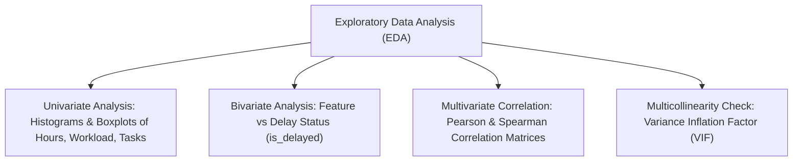

# ProjectPulse — Data Science Methodology

**Document Code:** DS-PP-V1.0  
**Target Release:** Internship MVP v1.0  
**Domain:** Predictive Analytics & Project Delay Classification  
**Status:** Approved  

---

## 1. Introduction & Scientific Objective

The primary objective of the Data Science component in ProjectPulse is to provide **early, explainable, probabilistic detection of project schedule delays**. 

Instead of treating risk assessment as an unquantifiable intuition or relying on opaque black-box deep learning architectures, ProjectPulse formulates delay prediction as a supervised machine learning classification and risk estimation task. This document details the end-to-end scientific methodology spanning data acquisition, preprocessing, feature engineering, model training, cross-validation, and real-time inference pipeline orchestration.

---

## 2. Dataset Requirements & Generation Methodology

### 2.1 Dataset Profile
To train the baseline Machine Learning model prior to deployment, the system requires a dataset representing diverse project management archetypes (software projects, web development, cloud migrations, infrastructure builds).

| Dimension | Target Specification |
| :--- | :--- |
| **Observation Unit** | Single Project state snapshot at a specific point in its lifecycle |
| **Sample Size ($N$)** | $1,000$ to $5,000$ validated project observation records |
| **Class Balance** | Representative distribution: $\approx 60\%$ on-time / minimal slip (`is_delayed = 0`), $\approx 40\%$ delayed (`is_delayed = 1`) |
| **Data Attributes** | 12 operational features + 1 ground-truth binary label (`is_delayed`) + continuous delay slip target (`delay_days`) |

### 2.2 Data Generation / Collection Strategy (Controlled Synthetic Simulation)
Because historical project telemetry across enterprise tools is often proprietary, private, or inconsistently formatted, an internship-grade MVP requires a **rigorous, rule-grounded synthetic project generation script** (`generate_dataset.py`).

The simulation adheres to grounded empirical software engineering dynamics:
1. **Workload Overload Factor:** When $\text{average\_workload} > \text{team capacity}$ by $> 25\%$, the probability of delay increases non-linearly.
2. **Hour Slippage Ratio:** When $\text{actual\_hours} / \text{estimated\_hours} > 1.20$, probability of delay scales proportionally.
3. **Complexity & Dependencies:** Projects with high mean complexity ($\ge 2.5$) and $> 5$ blocking dependencies experience compounding schedule risks.
4. **Deadline Runway:** Low deadline days remaining relative to pending tasks triggers acute schedule pressure.
5. **Controlled Gaussian Noise:** To avoid deterministic leakage, Gaussian noise ($\mu = 0, \sigma = 0.08$) is injected into the simulated target threshold.

```
[ Domain Rules & Distributions ] ──> [ Controlled Simulation Engine ] ──> [ Raw Dataset (CSV) ]
  • Workload capacity bounds           • Correlated feature generation       • 12 Predictors
  • Hour slippage distributions        • Injected Gaussian noise             • Ground Truth Label
  • Dependency drag coefficients       • Realistic constraint validation
```

---

## 3. Data Cleaning & Preprocessing

The preprocessing pipeline ensures data sanitization, type consistency, and mathematical validity before modeling:

1. **Missing Value Imputation:**
   - Numerical metrics (`actual_hours`, `previous_delays`): Imputed with median or zero depending on logical context.
   - Categorical fields: Mapped deterministically to ordinal or numerical equivalents.
2. **Outlier Filtering & Winsorization:**
   - Extreme anomalous inputs (e.g., negative hours, zero team members, or $> 1000$ tasks in a micro-project) are capped or filtered using interquartile range (IQR) boundaries.
3. **Consistency Verification:**
   - Enforce invariant constraints: $\text{completed\_tasks} + \text{pending\_tasks} = \text{total\_tasks}$.
   - Ensure non-negative bounds: $\text{estimated\_hours} \ge 0$, $\text{actual\_hours} \ge 0$, $\text{budget\_utilization} \ge 0.0$.

---

## 4. Exploratory Data Analysis (EDA) Protocol

The EDA phase establishes baseline distributions and validates feature correlations prior to training:



### Key Statistical Checks
- **Pearson / Spearman Correlation Heatmaps:** Identify features with high linear or monotonic association with the target label (e.g., strong positive correlation between `actual_vs_estimated_ratio` and `is_delayed`).
- **Variance Inflation Factor (VIF):** Screen for redundant collinear pairs (e.g., `completed_tasks` vs `total_tasks`), allowing the feature engineering stage to compress them into informative ratios.

---

## 5. Feature Engineering

Raw operational project metrics are transformed into 12 dense, predictive features:

| Feature Identifier | Transformation / Formula | Business Rationale |
| :--- | :--- | :--- |
| `team_size` | $N_{\text{members}}$ | Baseline capacity indicator. |
| `total_tasks` | $N_{\text{total}}$ | Project scale and scope complexity. |
| `completed_tasks` | $N_{\text{completed}}$ | Absolute delivered progress. |
| `pending_tasks` | $N_{\text{total}} - N_{\text{completed}}$ | Remaining operational burden. |
| `avg_workload` | $\frac{\text{Remaining Estimated Hours}}{\text{team\_size}}$ | Direct pressure per contributor. |
| `estimated_hours` | $\sum \text{Task Estimated Hours}$ | Initial scope sizing. |
| `actual_hours` | $\sum \text{Task Actual Hours}$ | Realized operational effort. |
| `deadline_days_remaining` | $\max(0, \text{Deadline Date} - \text{Current Date})$ | Available delivery runway. |
| `previous_delays` | Count of late historical milestones/tasks | Team/project historical velocity inertia. |
| `budget_utilization` | $\frac{\text{Actual Spend}}{\text{Total Budget}}$ | Capital consumption pace. |
| `task_complexity` | $\frac{1}{N_{\text{tasks}}} \sum \text{Complexity}_i$ (Scale 1–3) | Average intellectual/technical difficulty. |
| `dependencies` | Count of tasks marked `has_dependencies = True` | Scheduling friction and blocking drag. |

---

## 6. Feature Selection & Dimensionality Verification

Because the feature space is compact ($d = 12$) and domain-engineered, aggressive dimensionality reduction techniques (e.g., PCA) are intentionally avoided to **preserve model explainability**.

To verify feature relevance:
1. **Tree-Based Feature Importance (MDI):** Evaluates Mean Decrease in Impurity across Random Forest decision trees.
2. **Permutation Importance:** Measures the decrease in model score when a single feature value is randomly shuffled, ensuring no single synthetic feature introduces spurious correlation.

---

## 7. Model Training & Validation Protocol

### 7.1 Train / Test Split
To guard against data leakage and overfitting:
- **Partition Ratio:** $80\%$ Training Set ($D_{\text{train}}$), $20\%$ Holdout Test Set ($D_{\text{test}}$).
- **Stratification:** Splitting is stratified across the target variable `is_delayed` to preserve identical class ratios across both folds.
- **Random Seed:** Fixed seed (`random_state = 42`) for full reproducibility.

### 7.2 Model Architecture Selection: Random Forest Classifier
The Random Forest Classifier was chosen over alternative algorithms for the MVP due to several key advantages:

| Algorithm Consideration | Random Forest Classifier | Linear Logistic Regression | Deep Neural Network |
| :--- | :--- | :--- | :--- |
| **Non-Linear Interactions** | **High** (Captures complex feature interactions naturally) | Low (Requires manual interaction terms) | High |
| **Explainability** | **High** (Feature importance, tree depth tracing) | Moderate (Odds ratios) | Very Low (Black box) |
| **Resistance to Overfitting**| **High** (Ensemble bootstrap aggregation) | Moderate | Low (High risk on small tabular data) |
| **Inference Latency** | **Sub-millisecond** ($< 5\text{ ms}$) | Sub-millisecond | High (GPU or heavy runtime overhead) |
| **Data Scaling Sensitivity** | **None** (Invariant to monotonic transformations) | High (Requires scaling) | High (Requires scaling) |

### 7.3 Hyperparameter Tuning Strategy
Hyperparameters are tuned using `GridSearchCV` or `StratifiedKFold` cross-validation ($k=5$ folds) across:
- `n_estimators`: `[50, 100, 150]`
- `max_depth`: `[4, 6, 8, None]`
- `min_samples_split`: `[2, 5, 10]`
- `min_samples_leaf`: `[1, 2, 4]`
- `class_weight`: `'balanced'` (to mitigate any class skew)

---

## 8. Model Evaluation Framework

Evaluation will be conducted strictly against the held-out test split using standard classification metrics:

$$\text{Accuracy} = \frac{TP + TN}{TP + TN + FP + FN}$$

$$\text{Precision} = \frac{TP}{TP + FP}, \quad \text{Recall} = \frac{TP}{TP + FN}$$

$$\text{F1-Score} = 2 \times \frac{\text{Precision} \times \text{Recall}}{\text{Precision} + \text{Recall}}$$

> [!IMPORTANT]
> In accordance with scientific integrity standards, no fabricated numerical performance figures are stated prior to model execution. The actual numerical metrics (Accuracy, Precision, Recall, F1, Confusion Matrix) will be computed and logged directly during dataset training and reported in the project execution records.

---

## 9. Real-Time Prediction & Scoring Pipeline

Once serialized to `model.joblib`, the inference pipeline operates deterministically inside the API service:

```
[ Live Project Request ]
          │
          ▼
[ Query DB Tables ] ──> Aggregate project, task, and team records
          │
          ▼
[ Feature Extraction ] ──> Assembles 12-element numeric array
          │
          ▼
[ RF Inference: predict_proba ] ──> Yields Probability P(delay = 1)
          │
          ▼
[ Risk Score Calculation ] ──> Standardized to integer 0–100 scale
          │
          ▼
[ Expected Delay Estimation ] ──> Computes estimated slip in days
          │
          ▼
[ Heuristic Recommendation Rules ] ──> Evaluates operational condition triggers
          │
          ▼
[ Return JSON + Store in predictions DB ]
```

---

## 10. Methodological Limitations & Mitigation

1. **Synthetic Training Distribution:** While synthetic data generation adheres to empirical software project dynamics, it cannot capture unquantifiable human factors (e.g., sudden sickness, executive reprioritization).  
   *Mitigation:* The risk score is presented as a supportive decision aid, paired with transparent heuristic recommendations.
2. **Cold-Start for Zero-Task Projects:** A newly created project with zero tasks lacks feature velocity.  
   *Mitigation:* The system enforces a validation guard returning HTTP 422 until at least one task is created.
3. **Tabular Focus:** The model evaluates tabular operational metrics rather than natural language commit logs or code complexity.  
   *Mitigation:* Appropriate for an internship-scoped MVP that prioritizes stability, interpretability, and low runtime overhead.
