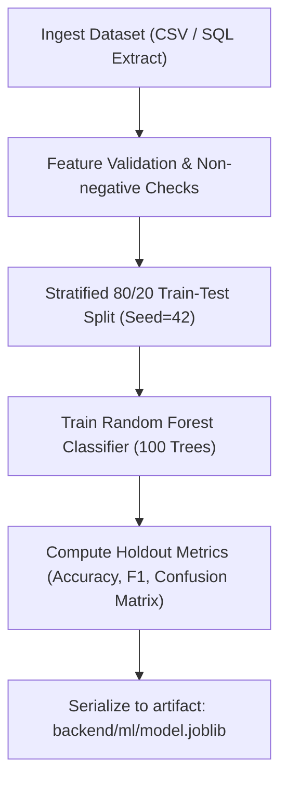

# ProjectPulse — Machine Learning Model Specification

**Document Code:** ML-SPEC-PP-V1.0  
**Target Release:** Internship MVP v1.0  
**Model Family:** Supervised Ensemble Classifier (Random Forest)  
**Artifact Format:** Joblib Serialized Binary (`model.joblib`)  
**Status:** Approved  

---

## 1. Problem Definition

In software project management, deadline slippage is rarely caused by a single isolated event; it emerges from compounding operational pressures such as task backlog, individual overload, under-estimated effort, and dependency blocking.

The Machine Learning subsystem in ProjectPulse defines the task as:
> **Given a vector of 12 real-time operational project features, predict the probability $P(\text{delay} = 1)$ that the project will miss its scheduled completion deadline, calculate an explainable Risk Score (0–100), classify the project into a discrete Risk Level (Low, Medium, High), and estimate the Expected Delay in calendar days.**

---

## 2. Target Variable Formulation

| Target Variable | Data Type | Permissible Values | Definition |
| :--- | :--- | :--- | :--- |
| `is_delayed` (Primary Target) | Binary Integer | `0` or `1` | `0`: Project completed on or before target deadline.<br>`1`: Project breached target deadline. |
| `expected_delay_days` (Derived Target) | Continuous Float | $\ge 0.0$ | Estimated number of calendar days of delivery slippage. |

---

## 3. Input Feature Specification

The model consumes exactly 12 numerical features derived from project, task, and team tables:

| Index | Feature Name | Data Type | Unit / Scale | Value Range | Description |
| :---: | :--- | :--- | :--- | :--- | :--- |
| **1** | `team_size` | Integer | Count | $[1, 100]$ | Number of active contributors assigned to project. |
| **2** | `total_tasks` | Integer | Count | $[1, 1000]$ | Total count of all project tasks. |
| **3** | `completed_tasks` | Integer | Count | $[0, 1000]$ | Count of tasks marked `Completed`. |
| **4** | `pending_tasks` | Integer | Count | $[0, 1000]$ | Count of tasks marked `To Do` or `In Progress`. |
| **5** | `avg_workload` | Float | Hours / Member | $[0.0, 168.0]$ | Ratio of pending estimated hours to team size. |
| **6** | `estimated_hours` | Float | Hours | $[0.0, 10000.0]$ | Total planned hours for all tasks. |
| **7** | `actual_hours` | Float | Hours | $[0.0, 15000.0]$ | Cumulative actual hours logged to date. |
| **8** | `deadline_days_remaining`| Float | Calendar Days | $[0.0, 365.0]$ | Number of days between today and target deadline. |
| **9** | `previous_delays` | Integer | Count | $[0, 50]$ | Count of missed milestones or overdue past tasks. |
| **10**| `budget_utilization` | Float | Ratio | $[0.0, 5.0]$ | $\frac{\text{Actual Cost}}{\text{Total Budget}}$. $1.0 = 100\%$ budget spent. |
| **11**| `task_complexity` | Float | Average Score | $[1.0, 3.0]$ | Mean complexity of tasks ($1 = \text{Low}, 2 = \text{Med}, 3 = \text{High}$). |
| **12**| `dependencies` | Integer | Count | $[0, 500]$ | Total tasks with `has_dependencies = True`. |

---

## 4. Machine Learning Model Architecture: Random Forest Classifier

### 4.1 Theoretical Rationale
A **Random Forest Classifier** is an ensemble learning method that constructs a collection of $B$ decorrelated decision trees during training and outputs the class mode (or class probability averages) across individual trees:

$$P(\text{delay} = 1 \mid \mathbf{x}) = \frac{1}{B} \sum_{b=1}^{B} p_b(\text{delay} = 1 \mid \mathbf{x})$$

Where:
- $\mathbf{x} \in \mathbb{R}^{12}$ is the 12-dimensional feature vector.
- $B$ is the number of decision trees (`n_estimators`).
- $p_b$ is the posterior class probability estimated by the $b$-th tree leaf node.

### 4.2 Algorithm Configuration & Hyperparameters

```python
from sklearn.ensemble import RandomForestClassifier

rf_pipeline = RandomForestClassifier(
    n_estimators=100,          # Ensemble size: 100 decorrelated decision trees
    criterion="gini",          # Split criterion: Gini impurity
    max_depth=6,               # Constrained tree depth to prevent leaf overfitting
    min_samples_split=5,       # Minimum samples required to split internal node
    min_samples_leaf=2,        # Minimum samples required at leaf node
    max_features="sqrt",       # Feature subset size per split: sqrt(12) ≈ 3 features
    bootstrap=True,            # Bootstrap aggregation (bagging) enabled
    class_weight="balanced",   # Automatically adjusts weights inversely proportional to class frequencies
    random_state=42,           # Deterministic seed for reproducible evaluation
    n_jobs=-1                  # Parallel multi-core CPU execution
)
```

---

## 5. Training Process & Serialization



1. **Feature Ingestion:** Load project observation records ensuring all 12 input columns match specification.
2. **Stratified Split:** Preserve delayed vs. on-time class proportions across $D_{\text{train}}$ ($80\%$) and $D_{\text{test}}$ ($20\%$).
3. **Training Execution:** Fit the 100-tree ensemble on $D_{\text{train}}$.
4. **Holdout Evaluation:** Evaluate predictions against $D_{\text{test}}$.
5. **Serialization:** Export the trained estimator to `model.joblib` along with feature column names metadata.

---

## 6. Evaluation Metrics Framework

The trained model will be comprehensively benchmarked against the following formal metrics on the held-out test split:

### 6.1 Formal Definitions
- **Accuracy:** Overall proportion of correct predictions:
  $$\text{Accuracy} = \frac{TP + TN}{TP + TN + FP + FN}$$
- **Precision:** Accuracy of positive delay alerts (minimizing false alarms):
  $$\text{Precision} = \frac{TP}{TP + FP}$$
- **Recall (Sensitivity):** Proportion of actual delayed projects successfully detected (minimizing dangerous false negatives):
  $$\text{Recall} = \frac{TP}{TP + FN}$$
- **F1-Score:** Harmonic mean balancing Precision and Recall:
  $$\text{F1} = 2 \times \frac{\text{Precision} \times \text{Recall}}{\text{Precision} + \text{Recall}}$$
- **Confusion Matrix:**
  $$\begin{pmatrix} TN & FP \\ FN & TP \end{pmatrix}$$

> [!NOTE]
> In an academic and internship context, precision and recall must be carefully balanced. In project delay forecasting, **Recall** is prioritized slightly over Precision because failing to detect an impending delay (False Negative) is significantly more detrimental to a project manager than investigating a minor false alarm (False Positive).

---

## 7. Probability Output, Risk-Score & Expected-Delay Formulation

### 7.1 Probability Output
The primary ML output is extracted via `predict_proba`:
$$p = P(\text{delay} = 1 \mid \mathbf{x}) \in [0.00, 1.00]$$

### 7.2 Risk Score Mathematical Formulation
To make the model intuitive for stakeholders, the raw probability $p$ is combined with operational strain metrics to form a standardized **Risk Score ($0 - 100$)**:

$$\text{Strain}_{\text{hours}} = \min\left(1.0, \; \max\left(0.0, \; \frac{\text{actual\_hours} - \text{estimated\_hours}}{\max(1.0, \text{estimated\_hours})}\right)\right)$$

$$\text{Strain}_{\text{budget}} = \min\left(1.0, \; \max\left(0.0, \; \text{budget\_utilization} - \frac{\text{completed\_tasks}}{\max(1, \text{total\_tasks})}\right)\right)$$

$$\text{Risk Score} = \text{round}\Big(100 \times \big(0.70 \times p + 0.15 \times \text{Strain}_{\text{hours}} + 0.15 \times \text{Strain}_{\text{budget}}\big)\Big)$$

### 7.3 Risk Level Classification
The resulting Risk Score maps into three clear managerial tiers:

| Risk Score Range | Classification | Indicator Color | Recommended Action Posture |
| :---: | :---: | :---: | :--- |
| **$0 - 39$** | **Low Risk** | Green | Project proceeding within normal operational variance. Maintain standard cadence. |
| **$40 - 69$** | **Medium Risk** | Amber | Emerging schedule or resource strain detected. Review workload and prioritize critical path. |
| **$70 - 100$** | **High Risk** | Red | Severe probability of schedule breach. Immediate scope rebalancing or deadline renegotiation required. |

### 7.4 Expected Delay Estimation
The estimated schedule slippage in calendar days is computed deterministically from model probability and operational velocity:

$$\text{Remaining Ratio} = \frac{\text{pending\_tasks}}{\max(1, \text{total\_tasks})}$$

$$\text{Burn Multiplier} = \max\left(1.0, \; \frac{\text{actual\_hours}}{\max(1.0, \text{estimated\_hours} \times (1 - \text{Remaining Ratio}))}\right)$$

$$\text{Expected Delay (days)} = \begin{cases} 
0.0 & \text{if } p < 0.25 \\
\text{round}\left(p \times \big(\text{Burn Multiplier} \times 14 + \text{previous\_delays} \times 2\big), 1\right) & \text{if } p \ge 0.25 
\end{cases}$$

This ensures the delay estimation is grounded, explainable, and returns $0$ for healthy projects while providing realistic calendar day slip estimates for at-risk initiatives.

---

## 8. Model Limitations & Assumptions

1. **Linear Time Invariance:** The model evaluates a point-in-time snapshot rather than a recurrent time-series sequence (e.g., LSTM).
2. **Fixed Scope Assumption:** The model assumes the current `total_tasks` reflects scope; it does not dynamically foresee unlogged future scope additions.
3. **Absence of Fabricated Metrics:** Actual quantitative test metrics will be produced exclusively upon running the training script with the generated dataset, ensuring zero empirical fabrication.
