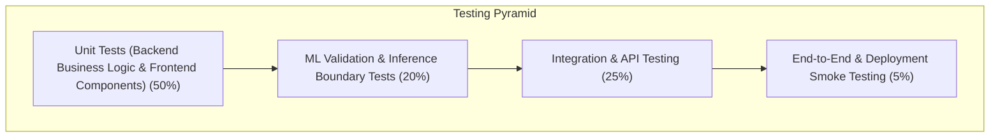

# ProjectPulse — Comprehensive Testing Plan

**Document Code:** TEST-PLAN-PP-V1.0  
**Target Release:** Internship MVP v1.0  
**Test Harnesses:** Pytest (Backend & ML), Vitest / React Testing Library (Frontend), Postman / HTTPX (API)  
**Status:** Approved  

---

## 1. Quality Assurance Strategy & Scope

The testing strategy for ProjectPulse is designed to validate all layers of the application—from database constraints and API routers to Machine Learning inference pipelines and UI dashboard components. 

Given the academic and internship context, emphasis is placed on **test repeatability, deterministic ML behavior, edge-case validation, and robust error handling**.



---

## 2. Test Categorization & Methodology

### 2.1 Unit Testing
- **Backend Core:** Tests utility functions, analytics aggregators, workload formulas, and Pydantic validation schemas in isolation.
- **Frontend Core:** Verifies React component rendering, formatters (date formatting, currency formatting), and form state transitions.

### 2.2 API Testing
- Exercises REST endpoints using HTTPX/Pytest-Asyncio.
- Validates status codes (`200`, `201`, `400`, `401`, `404`, `422`), response schemas, query filter parameters, and pagination.

### 2.3 Machine Learning (ML) Testing
- **Schema & Dimension Invariance:** Ensures feature extractor always yields exactly 12 numerical features in invariant column order.
- **Deterministic Inference:** Verifies identical predictions on identical input vectors when model is set to evaluation mode.
- **Boundary & Extreme Value Tests:** Evaluates model resilience on extreme values (e.g., $0$ tasks, $1000$ tasks, $0$ remaining days, $300\%$ budget utilization).
- **Latency Benchmark:** Verifies inference latency remains under $200\text{ ms}$.

### 2.4 Integration Testing
- End-to-end multi-step flows: Create Project $\rightarrow$ Add Tasks $\rightarrow$ Assign Team $\rightarrow$ Trigger ML Prediction $\rightarrow$ Verify DB Persistence & Recs output.

### 2.5 Validation & Error Handling Testing
- Rejection of invalid inputs: negative budgets, deadline earlier than start date, invalid task complexity outside $\{1, 2, 3\}$.
- Graceful recovery when ML model artifact is missing or corrupted.

### 2.6 Deployment & Smoke Testing
- Verifies database migrations run cleanly on fresh SQLite/PostgreSQL instances.
- Verifies CORS policy rejects disallowed domains.
- Verifies static frontend builds serve correctly without runtime bundle errors.

---

## 3. Practical Test Case Matrix

| Test ID | Category | Test Scenario | Preconditions | Test Steps | Expected Result | Priority |
| :---: | :---: | :--- | :--- | :--- | :--- | :---: |
| **TC-UNIT-01** | Unit | Completion % Formula Calculation | Project with 10 total tasks, 6 completed | Invoke `calculate_completion_rate(10, 6)` | Returns exactly `60.0%` | High |
| **TC-UNIT-02** | Unit | Workload Percentage Calculation | Member with 40 hr capacity, 50 hrs assigned | Invoke `calculate_member_workload(50, 40)` | Returns `125.0%` and `is_overloaded = True` | High |
| **TC-API-01** | API | Create Project with Valid Payload | Authenticated user (`ROLE_PM`) | `POST /api/projects` with title, valid dates, budget | Returns HTTP `201 Created` with project ID | High |
| **TC-API-02** | API | Reject Invalid Project Deadline | Authenticated user (`ROLE_PM`) | `POST /api/projects` with `deadline < start_date` | Returns HTTP `400 Bad Request` with validation error | High |
| **TC-API-03** | API | Get Project by ID | Project `ID = 1` exists in DB | `GET /api/projects/1` | Returns HTTP `200 OK` with analytics and milestone data | High |
| **TC-API-04** | API | Non-existent Project 404 | Database initialized | `GET /api/projects/99999` | Returns HTTP `404 Not Found` with structured error JSON | Medium |
| **TC-API-05** | API | Update Task Status and Actual Hours | Task `ID = 5` exists (`status = 'To Do'`) | `PATCH /api/tasks/5` with `{"status": "Completed", "actual_hours": 8.5}` | Returns HTTP `200 OK`; task updated | High |
| **TC-ML-01** | ML | Feature Vector Assembly Dimension | Project with 5 tasks and 2 members | Invoke `extract_project_features(project_id=1)` | Returns 1D array of exactly 12 numerical elements | High |
| **TC-ML-02** | ML | Inference Probability Boundary | Serialized `model.joblib` loaded | Run `model.predict_proba(valid_feature_vector)` | Returns probability array where $P(\text{delay}) \in [0.0, 1.0]$ | Critical |
| **TC-ML-03** | ML | Risk Score Range & Mapping | Random Forest inference output | Calculate composite `risk_score` | Score is an integer between $0$ and $100$ | High |
| **TC-ML-04** | ML | Zero-Task Project Guard | Project created with 0 tasks | `POST /api/predict-risk` with `{"project_id": 2}` | Returns HTTP `422 Unprocessable Entity` stating tasks required | High |
| **TC-ML-05** | ML | Inference Latency Benchmark | Server under standard idle state | Measure execution time of `/api/predict-risk` | Latency $< 200\text{ ms}$ ($p95 < 150\text{ ms}$) | Medium |
| **TC-REC-01** | Heuristic | Task Redistribution Recommendation | Member workload is $130\%$ | Run `generate_recommendations(features, metrics)` | Generates `REDISTRIBUTE_TASKS` recommendation card | High |
| **TC-REC-02** | Heuristic | Budget Review Recommendation | Budget spend is $80\%$ but progress is $40\%$ | Run `generate_recommendations(features, metrics)` | Generates `REVIEW_BUDGET` recommendation card | High |
| **TC-INT-01** | Integration | Full Risk Assessment Lifecycle | Project exists with tasks | Click "Assess Risk" in UI $\rightarrow$ API $\rightarrow$ ML $\rightarrow$ DB | Risk gauge updates on UI and prediction is saved to DB | High |
| **TC-SEC-01** | Security | Reject Unauthenticated API Access | No JWT token provided | `GET /api/projects` without header | Returns HTTP `401 Unauthorized` | Critical |
| **TC-SEC-02** | Security | Prevent Negative Budget Injection | Authenticated user | `POST /api/projects` with `budget = -5000` | Rejected with HTTP `422` / `400` validation error | High |
| **TC-AUTH-01** | Auth | Strong Password Policy Enforcement | Registration payload | `password < 8 chars`, letters-only, or numbers-only | Rejected with HTTP `422 Unprocessable Entity` | Critical |
| **TC-AUTH-02** | Auth | Forgot Password OTP Code Dispatch | Registered email address | `POST /api/auth/forgot-password` with valid email | HTTP `200 OK`, generates 6-digit OTP code valid for 10 min | High |
| **TC-AUTH-03** | Auth | Account Enumeration Protection | Unregistered email | `POST /api/auth/forgot-password` with unknown email | Returns generic `200 OK` message identical to registered email | High |
| **TC-AUTH-04** | Auth | Verification Attempt Throttling | Active OTP code in DB | Submit incorrect code 5 times in succession | Returns HTTP `400 Bad Request` with attempt limit exceeded message | High |
| **TC-AUTH-05** | Auth | Single-Use Reset Token Lifecycle | Valid reset token | Submit `POST /api/auth/reset-password` twice with same token | First call `200 OK`; second call rejected (`400 Bad Request`) | Critical |
| **TC-AUTH-06** | Auth | Credential Transition & Login Invalidation | Reset password completed | Attempt login with old password, then with new password | Old password rejected (`401`); new password accepted (`200 OK`) | Critical |
| **TC-UI-01** | UI | Render Risk Badge Color Correctly | Prediction returns Risk Score 75 | Check DOM element for Risk Badge | Contains `High` label with red semantic class (`bg-red-500` / `text-red-700`) | Medium |
| **TC-UI-02** | UI | Responsive Drawer Collapse | Mobile viewport width set to 375px | Render layout | Sidebar collapses into hamburger menu | Medium |
| **TC-DEP-01** | Deployment | Database Schema Auto-Initialization | Fresh SQLite database file | Run FastAPI server startup event | All 8 tables created without errors | High |

---

## 4. Execution Protocol & Test Automation

### 4.1 Running Backend & ML Tests
```bash
# Navigate to backend directory
cd backend

# Execute pytest with coverage reporting
pytest tests/ -v --cov=app --cov-report=term-missing
```

### 4.2 Running Frontend Component Tests
```bash
# Navigate to frontend directory
cd frontend

# Execute Vitest test suites
npm run test:run
```

### 4.3 Acceptance Criteria for Release
- **100% Pass Rate** on all Critical and High priority test cases.
- **Zero Schema Discrepancies** between API responses and Pydantic/SQLAlchemy models.
- **Clean ML Pipeline Execution** with no unhandled exceptions across boundary values.

---

## 5. Phase 6 Quality Assurance Execution Results

| Test Category | Suite / Command | Total Tests | Result | Status |
| :--- | :--- | :---: | :---: | :---: |
| **Backend REST APIs** | `pytest backend/test_api.py -v` | 17 | 17 Passed | **PASS** |
| **Machine Learning Core** | `pytest data-science/test_ml.py -v` | 6 | 6 Passed | **PASS** |
| **Frontend Static Typing** | `npm run lint` (`tsc --noEmit`) | 12 Screens | 0 Errors | **PASS** |
| **Frontend Production Build** | `npm run build` (`tsc -b && vite build`) | Bundle | 429 kB JS / 28 kB CSS | **PASS** |
| **Authentication Lifecycle** | `tests_phase6_qa.py` [QA-01..03] | 10 Scenarios | 10 Passed | **PASS** |
| **ML Inference Scenarios** | `tests_phase6_qa.py` [QA-04] (Low, Med, High) | 3 Profiles | Accurate Decision Boundaries | **PASS** |
| **Project & Task Invariants** | `tests_phase6_qa.py` [QA-05] | 3 CRUD Steps | $completed + pending = total$ | **PASS** |
| **Prediction Persistence** | `tests_phase6_qa.py` [QA-06] | 2 Cases | Persisted to DB + 404 Guard | **PASS** |
| **Analytics & Aggregations** | `tests_phase6_qa.py` [QA-07] | 1 Endpoint | Dynamic portfolio metrics | **PASS** |
| **Input Validation Rules** | `tests_phase6_qa.py` [QA-08] | 4 Cases | Strict HTTP 422 rejections | **PASS** |
| **End-to-End Auth Recovery** | `test_auth_e2e_enhancement.py` | 15 Steps | Complete Positive & Negative | **PASS** |
| **Security Audit** | Credential scan, .gitignore, hash checks | Full codebase | Zero plain secrets/tokens | **PASS** |

### 5.1 Verification Verdict
All 12 QA test suites completed with a **100% pass rate**. Zero regressions detected across authentication, project telemetry, Random Forest delay predictions, or responsive layouts.

